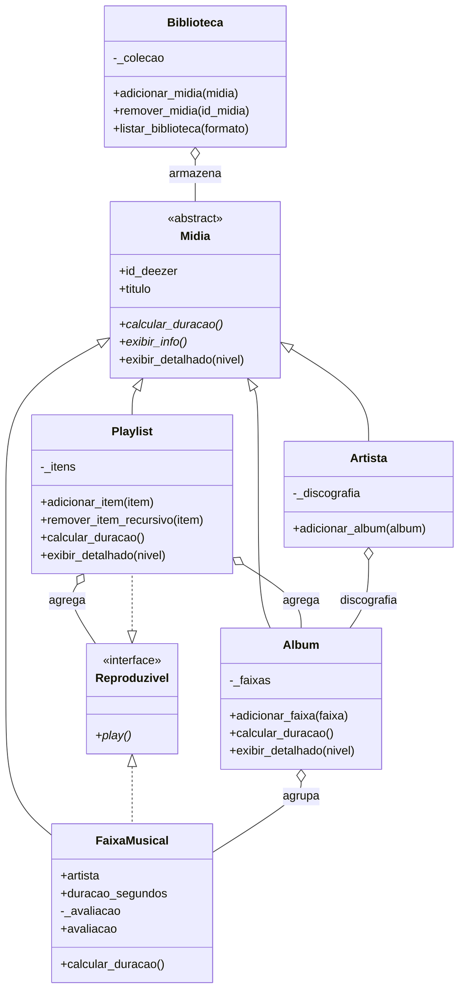
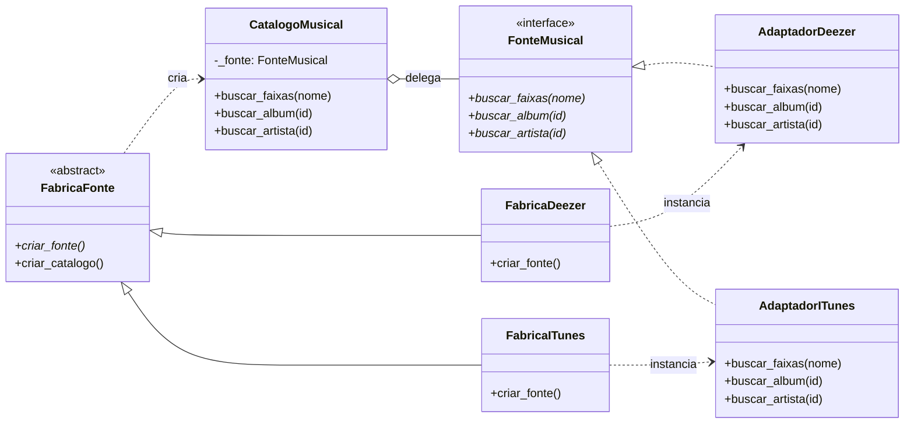
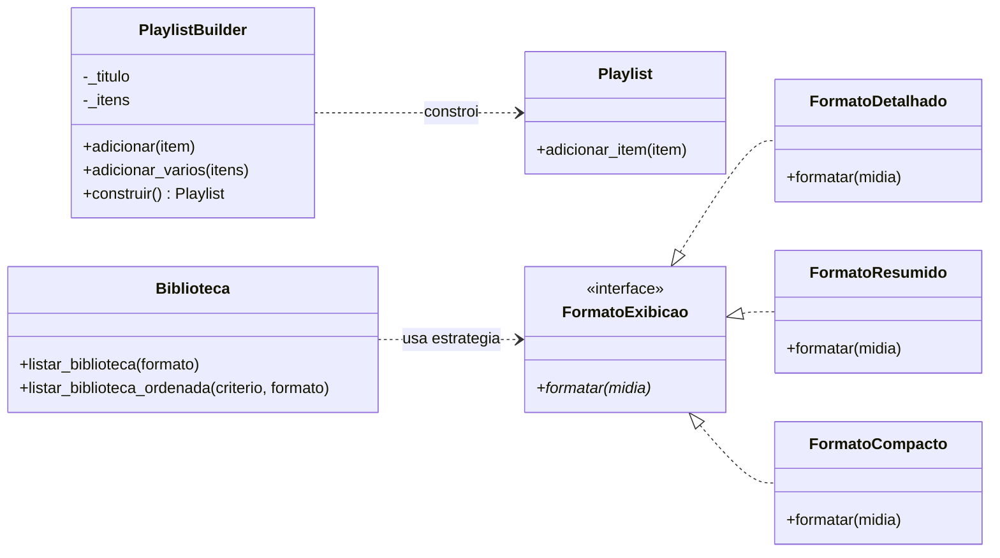

# Biblioteca Musical — Projeto de Software (UFAL, 2026.2)

Projeto acadêmico da disciplina **Projeto de Software**, com foco em **Programação Orientada a Objetos (POO)** e **padrões de projeto GoF**. Aplicação de console desenvolvida em **Python** para pesquisar músicas, álbuns e artistas em catálogos públicos (Deezer e iTunes), avaliar faixas, organizar uma biblioteca e construir playlists, inclusive aninhadas.

O propósito da implementação é demonstrar **como classes e objetos colaboram**, separando interface, regras de negócio, integrações externas e mecanismos de criação/apresentação. A aplicação é um **protótipo em memória**: o player é simulado e não há reprodução de áudio nem persistência em banco de dados.

> **Escopo desta documentação:** corresponde ao código da versão **Organizado e Comentado**. Os links apontam para caminhos **relativos ao projeto**, não para um repositório GitHub específico. Ao publicar o projeto no GitHub, os links para arquivos e linhas podem ser utilizados diretamente no repositório.

## 1. Requisitos de ambiente, instalação e execução

**Requisitos:** Python **3.10 ou superior**, `pip` e conexão com a internet **somente para consultas reais** às APIs. A dependência externa declarada é `requests`.

Abra um terminal na pasta `projeto_software_poo`, que contém `main.py` e `requirements.txt`:

```powershell
python -m pip install -r requirements.txt
python main.py
```

No Windows, caso o comando `python` não seja reconhecido, use `py` no lugar dele:

```powershell
py -m pip install -r requirements.txt
py main.py
```

O provedor padrão é o **Deezer**. A configuração está em [`integracoes/catalogo.py`](biblioteca_musical/integracoes/catalogo.py#L10-L23), na constante `PROVEDOR_ATUAL = "deezer"`. Para utilizar o iTunes, substitua por `"itunes"`, ou chame `configurar_provedor("itunes")` em código. São suportados **dois provedores** na versão entregue: iTunes e Deezer.

### Menu de funcionalidades

| Opção | Operação | Localização principal |
|---|---|---|
| 1 | Pesquisar faixa e atribuir nota inteira de 0 a 5 | [`menu.py`, `executar()`](biblioteca_musical/interface/menu.py#L312) e [`avaliar_e_guardar()`](biblioteca_musical/interface/menu.py#L23) |
| 2 | Adicionar faixa avaliada à biblioteca, impedindo ID duplicado | [`menu.py`](biblioteca_musical/interface/menu.py) e [`Biblioteca.adicionar_midia()`](biblioteca_musical/dominio/biblioteca.py#L25-L34) |
| 3 | Consultar o álbum associado a uma faixa armazenada | [`menu.py`](biblioteca_musical/interface/menu.py) e [`catalogo.buscar_album()`](biblioteca_musical/integracoes/catalogo.py#L42-L43) |
| 4 | Criar playlist inicialmente vazia | [`PlaylistBuilder`](biblioteca_musical/padroes/criacionais/builder.py#L9-L45) |
| 5 | Adicionar música, álbum ou sub-playlist a uma playlist | [`Playlist.adicionar_item()`](biblioteca_musical/dominio/midias.py#L124-L141) |
| 6 | Adicionar uma playlist criada à biblioteca | [`Biblioteca.adicionar_midia()`](biblioteca_musical/dominio/biblioteca.py#L25-L34) |
| 7 | Listar biblioteca, duração total e formato de exibição | [`Biblioteca.listar_biblioteca()`](biblioteca_musical/dominio/biblioteca.py#L116-L140) |
| 8 | Simular reprodução de faixas e playlists | [`simular_player()`](biblioteca_musical/interface/menu.py#L16) e [`midias.py`](biblioteca_musical/dominio/midias.py) |
| 9 | Remover mídia da biblioteca ou componente interno de playlist | [`Biblioteca.remover_midia()`](biblioteca_musical/dominio/biblioteca.py#L36-L72) |
| 10 | Ordenar biblioteca e escolher formato de apresentação | [`Biblioteca.listar_biblioteca_ordenada()`](biblioteca_musical/dominio/biblioteca.py#L74-L114) |
| 11 | Consultar artista associado a uma faixa da biblioteca | [`menu.py`](biblioteca_musical/interface/menu.py) e [`catalogo.buscar_artista()`](biblioteca_musical/integracoes/catalogo.py#L46-L47) |
| 12 | Adicionar/remover critérios de ordenação | [`editar_criterios_ordenacao()`](biblioteca_musical/interface/menu.py#L186) |
| 13 | Montar playlist de maneira guiada, em etapas (**Builder**) | [`criar_playlist_guiada()`](biblioteca_musical/interface/menu.py#L239-L288) |
| 14 | Exibir o feed de recomendações | [`exibir_recomendacoes()`](biblioteca_musical/interface/menu.py) |
| 0 | Encerrar a sessão | [`main.py`](main.py) e [`executar()`](biblioteca_musical/interface/menu.py#L312) |

**Observação:** os resultados das buscas dependem da disponibilidade das APIs. Consultas sem resultado ou determinadas falhas externas são tratadas sem encerrar a aplicação.

## 2. Estrutura de pacotes

```text
projeto_software_poo/
├── main.py                             # Ponto de entrada: python main.py
├── requirements.txt                    # Dependências Python
├── README.md                           # Documentação do projeto
├── .gitignore
├── docs/
│   └── MAPA_DO_CODIGO.md               # Guia de navegação pelos métodos
├── biblioteca_musical/
│   ├── __init__.py
│   ├── dominio/
│   │   ├── __init__.py
│   │   ├── midias.py                    # Midia, FaixaMusical, Album, Playlist, Artista
│   │   ├── biblioteca.py                # Coleção, remoção, exibição e ordenação
│   │   └── ordenacao.py                 # Registro extensível de critérios
│   ├── integracoes/
│   │   ├── __init__.py
│   │   └── catalogo.py                  # Configuração e seleção da fonte
│   ├── interface/
│   │   ├── __init__.py
│   │   └── menu.py                      # Menu e interação com usuário
│   └── padroes/
│       ├── __init__.py
│       ├── criacionais/
│       │   ├── __init__.py
│       │   ├── factory_method.py
│       │   └── builder.py
│       ├── estruturais/
│       │   ├── __init__.py
│       │   ├── adapter.py
│       │   └── facade.py
│       └── comportamentais/
│           ├── __init__.py
│           └── strategy.py
└── tests/
    ├── __init__.py
    ├── auxiliares.py                   # Cliente HTTP falso para os testes
    ├── test_criacionais.py
    ├── test_estruturais.py
    ├── test_comportamentais.py
    ├── test_dominio.py
    └── test_fluxo_menu.py
```

A divisão representa quatro camadas principais: **interface** (recebe comandos), **domínio** (representa e valida mídias), **integração** (seleciona a fonte) e **padrões GoF** (fábricas, construção, adaptação, fachada e estratégias). `main.py` permanece na raiz apenas para iniciar a aplicação. Os arquivos `__init__.py` marcam os pacotes Python e foram mantidos intencionalmente.

## 3. Requisitos funcionais e rastreabilidade

A tabela abaixo recupera a numeração **RF** presente no código e no README anterior. Ela descreve o **comportamento encontrado na implementação**, não substituindo uma especificação formal da disciplina que eventualmente tenha redação diferente.

| RF | Comportamento verificado no projeto | Onde está implementado | Evidência de teste |
|---|---|---|---|
| **RF1** | Pesquisar e avaliar uma faixa; nota precisa ser **inteira** entre **0 e 5** | [`FaixaMusical.avaliacao`](biblioteca_musical/dominio/midias.py#L61-L75), [`avaliar_e_guardar()`](biblioteca_musical/interface/menu.py#L23) | `test_avaliacao_integral` |
| **RF2** | Armazenar mídias sem duplicar identificadores e sem expor diretamente a coleção | [`Biblioteca._colecao`, `adicionar_midia`, `obter_itens`](biblioteca_musical/dominio/biblioteca.py#L13-L34) | `test_biblioteca_encapsula_duplicatas` |
| **RF3** | Modelar faixas, álbuns e playlists com comportamento próprio; pesquisar álbum relacionado e calcular durações por polimorfismo | [`Midia`, `FaixaMusical`, `Album`, `Playlist`](biblioteca_musical/dominio/midias.py), [`menu.py`](biblioteca_musical/interface/menu.py) | Testes de domínio e fluxo do menu |
| **RF4** | Exibir um feed unificado de faixas, álbuns e playlists na opção 14 | [`exibir_recomendacoes()`](biblioteca_musical/interface/menu.py) | Teste de fluxo do menu |
| **RF5** | Aceitar faixas e playlists no player e tratar artistas e álbuns de catálogo como mídia descritiva | [`Reproduzivel`](biblioteca_musical/dominio/midias.py), [`simular_player()`](biblioteca_musical/interface/menu.py) | Teste de fluxo do menu |
| **RF6** | Permitir playlists dentro de playlists, com proteção contra ciclos | [`Playlist.adicionar_item()` e `_contem_playlist()`](biblioteca_musical/dominio/midias.py#L124-L156) | `test_playlist_impede_ciclos_diretos_e_indiretos` |
| **RF7** | Tratar pesquisas vazias, dados ausentes e falhas externas previstas sem interromper o programa | [`AdaptadorHTTP._obter_json()`](biblioteca_musical/padroes/estruturais/adapter.py#L36-L44), adaptadores concretos | `test_falha_de_rede_e_http_retornam_resultado_vazio` |
| **RF8** | Ocultar a fonte de dados externa do menu e disponibilizar consultas por interface comum | [`FonteMusical` e adaptadores](biblioteca_musical/padroes/estruturais/adapter.py), [`CatalogoMusical`](biblioteca_musical/padroes/estruturais/facade.py), [`catalogo.py`](biblioteca_musical/integracoes/catalogo.py) | `test_fachada_troca_de_fonte` |
| **RF9** | Remover item da biblioteca e suas referências nas playlists conhecidas, inclusive aninhadas | [`Biblioteca.remover_midia()`](biblioteca_musical/dominio/biblioteca.py#L36-L72) e [`Playlist.remover_item_recursivo()`](biblioteca_musical/dominio/midias.py#L172-L189) | `test_remocao_cascata_e_aninhada` |
| **RF10** | Ordenar por critérios registrados e estender a lista de critérios sem alterar o algoritmo | [`ordenacao.py`](biblioteca_musical/dominio/ordenacao.py), [`Biblioteca.listar_biblioteca_ordenada()`](biblioteca_musical/dominio/biblioteca.py#L74-L114) | `test_criterios_extensiveis` |

O feed da opção 14 usa os dados da sessão. Ele sugere até cinco itens de cada tipo, priorizando as melhores notas das faixas relacionadas a cada item. Álbuns de catálogo continuam disponíveis como componentes de playlists e contam na duração total.

## 4. Padrões de projeto: visão geral

Os trabalhos sobre padrões GoF da disciplina foram contemplados com **dois criacionais, dois estruturais e um comportamental**. Além deles, há uma estrutura **inspirada em Composite** no domínio.

| Família | Padrão | Participantes no código | Finalidade |
|---|---|---|---|
| **Criacional** | **Factory Method** | [`FabricaFonte`, `FabricaDeezer`, `FabricaITunes`](biblioteca_musical/padroes/criacionais/factory_method.py) | Delegar a subclasses a criação da fonte musical |
| **Criacional** | **Builder** | [`PlaylistBuilder`](biblioteca_musical/padroes/criacionais/builder.py) | Montar playlists em etapas |
| **Estrutural** | **Adapter** | [`FonteMusical`, `AdaptadorDeezer`, `AdaptadorITunes`](biblioteca_musical/padroes/estruturais/adapter.py) | Converter respostas incompatíveis de APIs em objetos do domínio |
| **Estrutural** | **Facade** | [`CatalogoMusical`](biblioteca_musical/padroes/estruturais/facade.py) | Simplificar as operações de consulta |
| **Comportamental** | **Strategy** | [`FormatoExibicao`, `FormatoDetalhado`, `FormatoResumido`, `FormatoCompacto`](biblioteca_musical/padroes/comportamentais/strategy.py) | Trocar a maneira de mostrar mídias em tempo de execução |
| **Estrutura relacionada** | **Composite (inspirado)** | [`Midia`, `FaixaMusical`, `Album`, `Playlist`](biblioteca_musical/dominio/midias.py) | Tratar mídias individuais e agrupamentos com operações compartilhadas e recursão |

> **Distinção importante:** o Factory Method está no método `criar_fonte()` sobrescrito pelas subclasses, **não** somente no dicionário `FABRICAS`. O Adapter **traduz formatos**; a Facade **simplifica chamadas**. A organização de playlists é **inspirada** no Composite; não afirmamos que todos os detalhes do padrão GoF clássico tenham sido implementados.

## 5. Padrões aplicados: conceito, localização, código e justificativa

### 5.1. Factory Method — criacional

**O que é:** a classe criadora define um método para produzir um objeto, mas delega às subclasses a escolha da implementação concreta.

**Problema anterior:** o arquivo de integração utilizava verificações condicionais de provedor nas funções de consulta. Isso espalhava o conhecimento da fonte e dificultava acrescentar implementações sem modificar a lógica de seleção.

**Papéis na implementação:**

| Papel GoF | Classe / método | Arquivo |
|---|---|---|
| Creator | `FabricaFonte` | [`factory_method.py`, L12](biblioteca_musical/padroes/criacionais/factory_method.py#L12) |
| Factory Method | `criar_fonte()` | [`factory_method.py`, L19–22](biblioteca_musical/padroes/criacionais/factory_method.py#L19-L22) |
| Concrete Creators | `FabricaDeezer`, `FabricaITunes` | [`factory_method.py`, L26–34](biblioteca_musical/padroes/criacionais/factory_method.py#L26-L34) |
| Product (interface) | `FonteMusical` | [`adapter.py`, L12–25](biblioteca_musical/padroes/estruturais/adapter.py#L12-L25) |
| Concrete Products | `AdaptadorDeezer`, `AdaptadorITunes` | [`adapter.py`](biblioteca_musical/padroes/estruturais/adapter.py) |
| Seleção da fábrica | `FABRICAS` e `_catalogo_por_nome()` | [`catalogo.py`, L10–34](biblioteca_musical/integracoes/catalogo.py#L10-L34) |

**Trecho real — classe criadora e criadores concretos:**

```python
class FabricaFonte(ABC):
    def criar_catalogo(self):
        return CatalogoMusical(self.criar_fonte())

    @abstractmethod
    def criar_fonte(self):
        pass

class FabricaDeezer(FabricaFonte):
    def criar_fonte(self):
        return AdaptadorDeezer()

class FabricaITunes(FabricaFonte):
    def criar_fonte(self):
        return AdaptadorITunes()
```

**Uso efetivo:** [`_catalogo_por_nome()`](biblioteca_musical/integracoes/catalogo.py#L30-L34) escolhe uma classe-fábrica pelo registro e chama `criar_catalogo()`. Este chama `self.criar_fonte()`, cujo resultado depende da classe concreta.

**Justificativa:** a lógica que utiliza o catálogo conhece uma **abstração** de fonte musical. Para adicionar um provedor, é possível criar outro adaptador e outra fábrica e registrá-los no ponto de configuração, preservando as chamadas do menu e o contrato de consulta.

**Custo e alternativa:** adiciona fábricas pequenas. Um registro de construtores seria mais simples para poucos provedores; o Factory Method foi escolhido para demonstrar delegação de criação por herança. **Abstract Factory** não se justifica aqui porque não existe a necessidade de criar várias famílias coordenadas de produtos.

**Teste:** [`test_factory_method_seleciona_implementacao()`](tests/test_criacionais.py).

### 5.2. Builder — criacional

**O que é:** separa a construção de um objeto de sua utilização, permitindo montar seus componentes passo a passo antes de entregar o resultado.

**Problema anterior:** a interface precisava organizar manualmente os componentes de uma playlist, misturando validação da construção com interação de terminal.

**Papéis:** Builder = `PlaylistBuilder`; produto = `Playlist`; cliente = `criar_playlist_guiada()` no menu.

**Trecho real — [`builder.py`, L19–45](biblioteca_musical/padroes/criacionais/builder.py#L19-L45):**

```python
class PlaylistBuilder:
    def __init__(self, titulo):
        titulo = titulo.strip()
        if not titulo:
            raise ValueError("O título da playlist não pode estar vazio.")
        self._titulo = titulo
        self._itens = []

    def adicionar(self, item):
        if not Playlist.aceita_item(item):
            raise TypeError("A playlist aceita itens reproduzíveis e álbuns.")
        self._itens.append(item)
        return self

    def construir(self):
        playlist = Playlist(f"pl-{uuid4().hex}", self._titulo)
        for item in self._itens:
            if not playlist.adicionar_item(item):
                raise ValueError("Não foi possível adicionar um componente à playlist.")
        return playlist
```

A classe também disponibiliza `adicionar_varios()`, que chama `adicionar()` para cada item. A finalização utiliza um identificador local `pl-...` para distinguir as playlists criadas das mídias obtidas por serviços externos.

**Uso efetivo — [`menu.py`, L239–288](biblioteca_musical/interface/menu.py#L239-L288):**

```python
builder = PlaylistBuilder(titulo)
# ... para cada item selecionado na montagem:
builder.adicionar(candidatos[indice])
# ... ao finalizar:
playlist = builder.construir()
```

**Justificativa:** permite criação progressiva, validação do contrato de reprodução e reutilização da montagem na opção **13** (playlist guiada) e na opção **4** (playlist vazia). `construir()` devolve um objeto novo a cada chamada.

**Custo e alternativa:** há uma classe adicional para criar um objeto relativamente simples. Sem a necessidade de montagem guiada, chamar `Playlist(...).adicionar_item(...)` diretamente poderia ser suficiente. **Prototype** não atende ao caso porque não estamos clonando playlists existentes.

**Testes:** `test_builder_monta_itens_de_tipos_diferentes`, `test_builder_sem_itens_e_ids_unicos`, `test_builder_valida_titulo_e_componentes`, `test_builder_reutilizado_cria_playlists_independentes` em [`test_criacionais.py`](tests/test_criacionais.py).

### 5.3. Adapter — estrutural

**O que é:** converte a interface de um serviço externo na interface que o sistema espera utilizar.

**Problema anterior:** Deezer e iTunes retornam JSON com campos distintos. Deezer fornece, por exemplo, `title`, `duration` e dados internos de `artist`, enquanto iTunes fornece `trackName`, `trackTimeMillis` e `artistName`. Sem adaptação, o menu precisaria conhecer essas diferenças.

**Papéis:** Target = `FonteMusical`; Adapters = `AdaptadorDeezer` e `AdaptadorITunes`; serviços adaptados = endpoints HTTP de Deezer/iTunes; domínio comum = `FaixaMusical`, `Album`, `Artista`.

**Interface comum — [`adapter.py`, L12–25](biblioteca_musical/padroes/estruturais/adapter.py#L12-L25):**

```python
class FonteMusical(ABC):
    @abstractmethod
    def buscar_faixas(self, nome_musica):
        pass

    @abstractmethod
    def buscar_album(self, id_album):
        pass

    @abstractmethod
    def buscar_artista(self, id_artista):
        pass
```

**Conversão concreta — [`AdaptadorITunes.buscar_faixas()`](biblioteca_musical/padroes/estruturais/adapter.py#L109-L127):**

```python
faixa = FaixaMusical(
    registro["trackId"], registro["trackName"],
    registro["artistName"], registro.get("trackTimeMillis", 0) // 1000,
    id_album=album_id, id_artista=registro.get("artistId"),
)
```

O `// 1000` transforma **milissegundos em segundos**, padronizando a duração usada pelo domínio. No `AdaptadorDeezer`, a construção utiliza os campos da Deezer e a duração que ela já fornece em segundos. Ambos retornam resultados compatíveis com o restante do sistema.

**Tratamento de falhas:** [`AdaptadorHTTP._obter_json()`](biblioteca_musical/padroes/estruturais/adapter.py#L36-L44) centraliza requisições e devolve `{}` em falhas previstas de conexão, HTTP ou JSON. Os adaptadores convertem resultados vazios em `[]` ou `None`, conforme a operação.

**Justificativa:** isola diferenças de provedores em classes especializadas, protege o domínio contra formatos externos e permite testar as conversões separadamente.

**Custo e alternativa:** são necessárias classes de adaptação e um contrato comum. **Bridge** serviria melhor para separar duas dimensões variáveis planejadas desde o início; neste caso a necessidade é adaptar APIs **já existentes e incompatíveis**. **Proxy** seria mais adequado se o problema principal fosse controle de acesso ou cache de consultas.

**Testes:** [`test_estruturais.py`](tests/test_estruturais.py), incluindo conversão de unidades, montagem de álbuns, artist lookup, dados incompletos e falhas.

### 5.4. Facade — estrutural

**O que é:** disponibiliza uma interface simples e coesa para as operações de um subsistema, deixando a implementação interna sob responsabilidade de outros objetos.

**Problema anterior:** o consumidor não deveria criar diretamente clientes HTTP, interpretar JSON ou decidir como cada serviço executa suas consultas.

**Papéis:** Facade = `CatalogoMusical`; componente encapsulado = uma instância de `FonteMusical` (implementada pelos adaptadores); cliente = módulo de integração e menu.

**Trecho real — [`facade.py`, L10–26](biblioteca_musical/padroes/estruturais/facade.py#L10-L26):**

```python
class CatalogoMusical:
    def __init__(self, fonte):
        if not isinstance(fonte, FonteMusical):
            raise TypeError("A fonte musical deve implementar FonteMusical.")
        self._fonte = fonte

    def buscar_faixas(self, nome_musica):
        return self._fonte.buscar_faixas(nome_musica)

    def buscar_album(self, id_album):
        return self._fonte.buscar_album(id_album)

    def buscar_artista(self, id_artista):
        return self._fonte.buscar_artista(id_artista)
```

**Uso efetivo:** [`integracoes/catalogo.py`](biblioteca_musical/integracoes/catalogo.py#L30-L47) oferece funções públicas `buscar_faixas()`, `buscar_album()` e `buscar_artista()`, que obtêm a fachada selecionada e delegam a pesquisa. O menu importa essas funções, sem depender diretamente de `AdaptadorDeezer` ou `AdaptadorITunes`.

**Justificativa:** reduz o conhecimento que a interface precisa ter do subsistema musical. O ponto de entrada para as operações permanece uniforme independentemente da fonte de dados.

**Custo e limite:** adiciona um nível de delegação, e a fachada é pequena porque o subsistema oferece somente três consultas. Ela não converte o JSON por conta própria — isso é tarefa dos **Adapters** —, nem impede acesso direto às classes internas por código que opte por usá-las.

**Testes:** `test_facade_delega_as_tres_operacoes_a_fonte` e `test_fachada_troca_de_fonte` em [`test_estruturais.py`](tests/test_estruturais.py).

### 5.5. Strategy — comportamental

**O que é:** define uma família de algoritmos intercambiáveis para realizar a mesma operação, permitindo selecionar o comportamento em tempo de execução.

**Problema anterior:** com um único formato de listagem fixo na biblioteca, cada variação de apresentação exigiria alteração nos métodos de listagem.

**Papéis:** Strategy = `FormatoExibicao`; ConcreteStrategies = `FormatoDetalhado`, `FormatoResumido`, `FormatoCompacto`; Context = `Biblioteca`; seleção = `escolher_formato()` no menu.

**Trecho real — [`strategy.py`, L10–31](biblioteca_musical/padroes/comportamentais/strategy.py#L10-L31):**

```python
class FormatoExibicao(ABC):
    @abstractmethod
    def formatar(self, midia):
        pass

class FormatoDetalhado(FormatoExibicao):
    def formatar(self, midia):
        return midia.exibir_detalhado()

class FormatoResumido(FormatoExibicao):
    def formatar(self, midia):
        return midia.exibir_info()

class FormatoCompacto(FormatoExibicao):
    def formatar(self, midia):
        return f"{type(midia).__name__}: {midia.titulo}"
```

**Delegação no contexto — [`biblioteca.py`, L127–133](biblioteca_musical/dominio/biblioteca.py#L127-L133):**

```python
formato = formato or FormatoDetalhado()
for midia in self._colecao.values():
    print(formato.formatar(midia))
    duracao_total += midia.calcular_duracao()
```

**Uso efetivo:** a função [`escolher_formato()`](biblioteca_musical/interface/menu.py#L219-L236) permite escolher a estratégia nas opções **7** e **10** do menu, sem alterar os objetos armazenados.

**Justificativa:** a biblioteca delega o formato a um objeto externo, respeitando a responsabilidade única. Uma quarta estratégia pode ser adicionada implementando `formatar()` sem reescrever `Biblioteca.listar_biblioteca()`.

**Custo e alternativa:** uma classe por formato. **State** não foi escolhido porque não há um ciclo de estados internos com transições; o usuário seleciona livremente um algoritmo de apresentação. Para um projeto menor, funções de formatação também poderiam ser usadas, mas não ilustrariam o Strategy orientado a objetos da mesma maneira.

**Testes:** [`test_comportamentais.py`](tests/test_comportamentais.py), inclusive um exemplo de nova estratégia de exibição sem alterar a biblioteca.

## 6. Estrutura recursiva inspirada em Composite

**Onde:** [`dominio/midias.py`](biblioteca_musical/dominio/midias.py). Há um contrato comum (`Midia`) e objetos que representam tanto **elementos individuais** quanto **agrupamentos**.

| Papel | Classe | Operação principal |
|---|---|---|
| Componente abstrato | `Midia` | `calcular_duracao()`, `exibir_info()`, `exibir_detalhado()` |
| Folha | `FaixaMusical` | Retorna a própria duração |
| Agregado de faixas | `Album` | Soma durações; percorre faixas na exibição detalhada |
| Agregado aninhável | `Playlist` | Soma durações de itens e percorre sub-playlists |

**Trechos reais:** [`Playlist.calcular_duracao()`](biblioteca_musical/dominio/midias.py#L192-L195) usa `sum(item.calcular_duracao() for item in self._itens)`. [`Playlist.exibir_detalhado()`](biblioteca_musical/dominio/midias.py#L200-L208) chama `item.exibir_detalhado(nivel + 1)` para cada componente. Como um item pode ser outra `Playlist` ou um `Album`, a operação percorre a estrutura recursivamente.

A classe `Playlist` mantém **referências a objetos que podem existir fora dela** (agregação). `Album` gerencia internamente sua lista de faixas. Em Python, essa modelagem não impõe automaticamente ciclo de vida físico dos componentes.

### Consistência: prevenção de ciclos

[`Playlist.adicionar_item()`](biblioteca_musical/dominio/midias.py#L124-L141) bloqueia elementos não reproduzíveis e impede que uma playlist seja inserida em si mesma, diretamente ou por uma sub-playlist. O método [`_contem_playlist()`](biblioteca_musical/dominio/midias.py#L143-L156) procura recursivamente a playlist-alvo, usando um conjunto de objetos **visitados** para não repeti-los.

**Por quê?** Sem esse controle, estruturas como `A → B → A` poderiam fazer `calcular_duracao()` e `exibir_detalhado()` entrar em recursão indefinida. A aplicação usa uma **variante inspirada no Composite**, não uma implementação canônica completa do padrão GoF.

### Remoção em cascata e referências compartilhadas

[`Biblioteca.remover_midia()`](biblioteca_musical/dominio/biblioteca.py#L36-L72) localiza as playlists sob controle da biblioteca e outras explicitamente fornecidas pelo menu; chama [`Playlist.remover_item_recursivo()`](biblioteca_musical/dominio/midias.py#L172-L189) e depois remove a mídia do índice principal.

O método `remover_item_recursivo()` compartilha o conjunto `_visitadas` entre chamadas, evitando percorrer uma sub-playlist compartilhada duas vezes. A cascata compara tipo e ID da mídia para encontrar itens equivalentes obtidos em buscas diferentes. [`Playlist.remover_item()`](biblioteca_musical/dominio/midias.py#L162-L170) remove **todas as ocorrências diretas da mesma referência**, sem apagar o objeto de outras coleções independentes.

**Limite conhecido:** a biblioteca só pode limpar referências em playlists que **conhece** ou que foram passadas explicitamente; ela não descobre automaticamente playlists mantidas por sistemas externos.

**Testes:** [`test_dominio.py`](tests/test_dominio.py), especialmente `test_composite_percorre_tres_niveis_e_soma_duracoes`, `test_playlist_impede_ciclos_diretos_e_indiretos`, `test_remocao_cascata_e_aninhada` e `test_remocao_compartilhada_atinge_subplaylist_apenas_uma_vez`.

## 7. Ordenação extensível sem modificar o algoritmo principal

O dicionário [`CRITERIOS_ORDENACAO`](biblioteca_musical/dominio/ordenacao.py#L9-L13) registra funções para ordenar por **título**, **duração** e **avaliação**.

```python
CRITERIOS_ORDENACAO = {
    'titulo': lambda midia: midia.titulo.lower(),
    'duracao': lambda midia: midia.calcular_duracao(),
    'avaliacao': lambda midia: getattr(midia, 'avaliacao', None)
        if getattr(midia, 'avaliacao', None) is not None else -1,
}
```

As funções [`registrar_criterio_ordenacao()`](biblioteca_musical/dominio/ordenacao.py#L16-L33) e [`remover_criterio_ordenacao()`](biblioteca_musical/dominio/ordenacao.py#L36-L43) alteram o registro sem precisar editar [`Biblioteca.listar_biblioteca_ordenada()`](biblioteca_musical/dominio/biblioteca.py#L74-L114), que busca a função de chave e chama `sorted()`.

A opção **12** permite gerenciar os critérios interativamente. O programa impede a substituição acidental de um critério existente e informa quando uma chave cadastrada é incompatível com algum objeto.

Essa solução é um **registro de funções** e uma demonstração de **extensibilidade**, não é declarada aqui como uma instância adicional do padrão GoF Strategy implementado por classes. O **Strategy explícito** do trabalho está na apresentação das mídias.

## 8. Diagramas de classes (Mermaid / UML simplificado)

Os diagramas a seguir foram escritos em Mermaid para visualização em repositórios compatíveis com Markdown. Representam as **relações relevantes**; não incluem todos os atributos e todos os métodos auxiliares.

### 8.1. Domínio musical e organização recursiva



### 8.2. Factory Method + Adapter + Facade



### 8.3. Builder + Strategy



## 9. Testes automatizados e evidências

A suíte utiliza **`unittest`**, da biblioteca padrão do Python, e organiza os testes por responsabilidade:

| Arquivo | Verificações principais |
|---|---|
| [`tests/test_criacionais.py`](tests/test_criacionais.py) | Seleção da fábrica, validação e montagem de playlists, IDs únicos e Builder reutilizado |
| [`tests/test_estruturais.py`](tests/test_estruturais.py) | Tradução de dados Deezer/iTunes, falhas HTTP, álbum, artista e delegação da Facade |
| [`tests/test_comportamentais.py`](tests/test_comportamentais.py) | Três formatos de exibição e inclusão de uma nova Strategy |
| [`tests/test_dominio.py`](tests/test_dominio.py) | Avaliação, duplicação, ciclos, recursão, remoção e sub-playlists compartilhadas |
| [`tests/test_fluxo_menu.py`](tests/test_fluxo_menu.py) | Fluxo simulado 1 → 2 → 3 → 11 → 0, referências e critérios de ordenação |
| [`tests/auxiliares.py`](tests/auxiliares.py) | `ClienteFake` e `RespostaFake` para testar HTTP sem rede real |

Execute **na pasta raiz** do projeto:

```powershell
python -m unittest discover -s tests -v
```

**Resultado verificado na versão documentada:** `Ran 27 tests ... OK` (27 testes aprovados). Os testes com API utilizam respostas simuladas e, por isso, **não demonstram disponibilidade atual da Deezer ou do iTunes**. Uma validação manual do fluxo de consulta real depende de conexão e das respostas desses serviços.

## 10. Atividades da disciplina: diagnóstico, mudanças e escolhas

Esta seção resume o raciocínio solicitado nos conteúdos de **padrões criacionais, estruturais e comportamentais**: identificar o problema, mostrar a solução aplicada e justificar por que não usar outros padrões apenas por obrigação.

### Padrões criacionais

| Padrão aplicado | Problema / sinal de alerta | Alteração realizada | Benefício / custo |
|---|---|---|---|
| Factory Method | Seleção condicional de provedores e criação concreta conhecida pelo cliente | `FabricaFonte.criar_fonte()` e criadores concretos | Criação substituível; aumenta o número de classes |
| Builder | Menu acumulava etapas de montagem de playlists | `PlaylistBuilder` e construção guiada | Separa montagem e interação; cria um objeto auxiliar |

**Não adotados:** `Abstract Factory` (não há famílias coordenadas de produtos), `Prototype` (não há necessidade de clonagem) e `Singleton` (não há necessidade de impor uma instância global única; isso também dificultaria testes).

### Padrões estruturais

| Padrão aplicado | Problema / sinal de alerta | Alteração realizada | Benefício / custo |
|---|---|---|---|
| Adapter | Contratos e JSON diferentes entre Deezer e iTunes | `FonteMusical` e dois adaptadores | Padroniza o domínio; mantém lógica por provedor |
| Facade | Menu não deveria conhecer detalhes do subsistema | `CatalogoMusical` e funções públicas de integração | Simplifica chamadas; acrescenta delegação |

**Organização adicional:** a modelagem de mídias permite agrupamentos recursivos inspirados no **Composite**, com prevenção de ciclos. **Não adotados formalmente:** `Decorator`, `Bridge`, `Proxy` e `Flyweight`, pois enriquecimento dinâmico, dimensões independentes, controle de acesso e compartilhamento de estado não eram necessidades centrais desta implementação.

### Padrão comportamental

| Padrão aplicado | Problema / sinal de alerta | Alteração realizada | Benefício / custo |
|---|---|---|---|
| Strategy | Formato da biblioteca preso à implementação da listagem | `FormatoExibicao` e três estratégias | Alternância em tempo de execução; uma classe por formato |

**Não adotados formalmente:** `State`, `Observer`, `Command` e `Template Method`. Em especial, **Strategy** foi escolhido em vez de **State** porque não existe uma máquina de estados que dirija mudanças automáticas de comportamento; o usuário escolhe o formato diretamente.

## 11. Limitações, trade-offs e possíveis evoluções

- **Persistência:** a biblioteca, playlists e notas ficam em memória. Ao sair, os dados da sessão não são salvos.
- **Reprodução:** `play()` produz **mensagens ilustrativas**. Não existe streaming, áudio, pausa ou avanço de faixa.
- **APIs públicas:** disponibilidade, catálogo e metadados dependem de serviços externos; resultados podem mudar.
- **Identificadores:** a biblioteca indexa mídias pelo campo histórico `id_deezer`, ainda que a mídia venha do iTunes. Esse nome é legado, e o modelo atual não utiliza uma chave composta por **provedor + identificador**; em cenários de mistura de fontes, colisões de IDs são uma limitação a resolver.
- **Escopo de remoção:** apenas referências em playlists conhecidas ou explicitamente fornecidas podem ser removidas em cascata.
- **Custos da arquitetura:** interfaces, fábricas, adapters e estratégias aumentam o número de módulos; justificam-se quando facilitam substituição, teste e manutenção.

Possíveis evoluções: persistência em SQLite, chaves de mídia com identificação do provedor, CLI para selecionar a fonte, interface gráfica, melhorias de cobertura de testes e um player real (com solução autorizada pela plataforma de áudio).